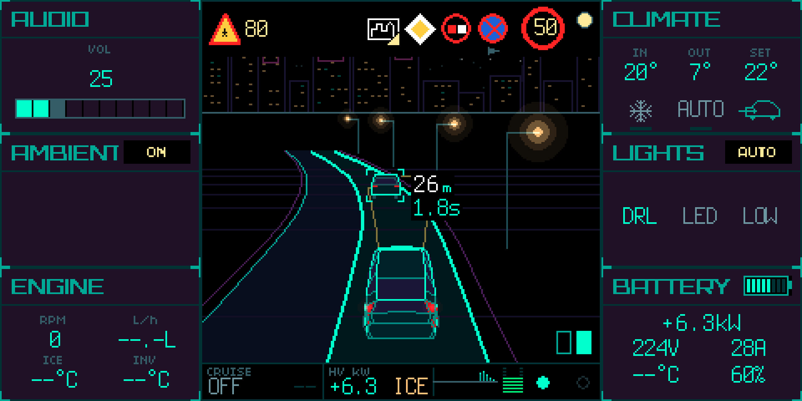
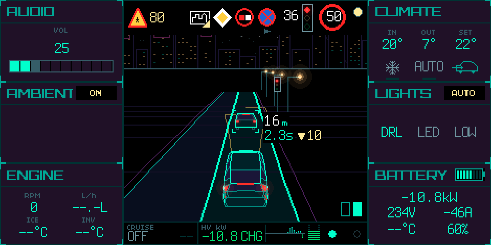
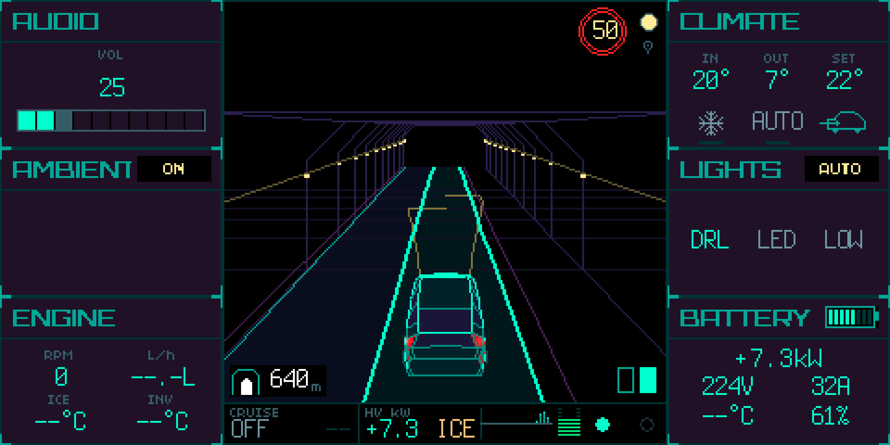

# roadsense

**Camera road perception for any car, on a phone.** A forward-looking camera watches the road; a
handful of small daemons turn the stream into structured road understanding (lanes, road edges,
lead vehicle, traffic lights, signs, scenery and an OpenStreetMap layer) and serve it over a local
HTTP / WebSocket API.



<sub>roadsense output as drawn by the [Prius car computer](#used-in-a-toyota-prius-gen-2-car-computer)
that uses it (headless render with simulated data).</sub>

* **Car-agnostic, device-agnostic.** Anything that fills the shared-memory frame ring is a camera;
  anything that speaks newline-delimited JSON is a consumer. The reference deployment is a
  Xiaomi Poco F1 running postmarketOS (mainline Linux), inference on its GPU through ncnn / Vulkan.
* **The API is the product.** Every result is a topic with a timestamp, a confidence and, where
  facts are combined, its provenance. A car gateway, a logger or a display is a separate project.
* **Informs, never controls.** roadsense gathers and serves data; it does not steer, brake or
  accelerate anything.
* In the spirit of [openpilot](https://github.com/commaai/openpilot) (its MIT supercombo model is
  used) and [flowpilot](https://github.com/flowdriveai/flowpilot) (GPL-3.0: ideas only, no code).

## What it serves

| Topic | Source | Content |
|---|---|---|
| `road` | modeld: openpilot supercombo (v0.9.7, MIT) | planned path, 4 lane lines and 2 road edges with probabilities, lead vehicles, ego pose, desire and meta state |
| `lanes` | api tracker | the road geometry over time: lane-line and edge presence with hysteresis, Kalman-filtered geometry, coasting through drop-outs |
| `lead` | api tracker | the lead vehicle: distance, relative speed, time gap, a live filtered value while standing, a "lead moved off" cue, raw vision value alongside |
| `lights` | sign provider + api | traffic lights with state, the ego light held over short misses, and the light assigned to the ego lane where several are visible |
| `signs`, `speed_limit`, `rules` | sign provider (optional) + api | sign tracks with persistent ids and best crop; the speed limit and rules in effect, recent and ahead |
| `env` | envd: zero-shot CLIP-type encoder, 1 fps | place (motorway, city, residential, forest road, tunnel, parking ...), weather and light, smoothed with confidence |
| `map` | mapd: position filter + OpenStreetMap pack | position state, matched road (class, lanes, tunnel, bridge, limit), look-ahead along the likely path: curves, junctions and roundabouts with their arms, crossings, signals, tunnel exit |
| `fused` | api | map and camera combined per fact with provenance: speed limit, built-up area, lane count and ego lane, tunnel with exit distance |
| `vehicle`, `objects`, `ego` | mapd, from the host's feeder | the car as the host describes it: motion, driver controls, body signals with age, quality and source per signal, calibration estimates; range-sensor object lists in the camera's frame |
| `view` | api (display channel) | for consumers that draw: lead, traffic lights, signs, lane lines and edges with stable ids, smoothed positions in the car frame, velocities for extrapolation, fades; and `view.road`, the road as one picture: the lane from the camera near the car and from the map beyond, side roads, the junction or roundabout ahead with its arms, lane count with the probability per lane and the ego lane, painted turn arrows, each part with provenance and an "approximate" mark on a weak position. Derived from the measurement topics, never fed back |
| `camera`, `health` | all daemons | frame metadata and MJPEG preview with overlays; fps, latency and temperature per stage |

Full contract, message formats and the REST / WebSocket reference: [docs/ARCHITECTURE.md](docs/ARCHITECTURE.md).

**roadsense 2.0** (api version 2): the measurement topics above say what was measured, as fresh as the model's
frame, and are what anything that decides should read; `view` is the display channel, smoothed and allowed
to lag, and is what anything that draws should read. What changed since 1.x (the frozen lead `hold` mode is
gone, the topic `roadgeom` became `view.road`, `fused.lanes` says "unknown" instead of guessing, map pack
format 2 with turn lanes, `/v2` paths): ARCHITECTURE.md, "roadsense 2.0: what changed since 1.x".

## Used in: a Toyota Prius Gen 2 car computer

[cyberpank-prius-gen2-computer](https://github.com/PiotrTopa/cyberpank-prius-gen2-computer) runs
roadsense on the same phone as its car backend, starts and stops it with the ignition, and draws the
result on the car's factory 480×240 multi-display. Lane lines, road edges, the lead vehicle with
distance, gap and closing speed, the ego traffic light, warning signs, the speed limit, scenery from
`env`, and from `map` / `fused` the next limit, the lane count and the tunnel exit. The car's motion
(wheel speed, yaw rate) and GNSS go in through the position API. Screen layout and scene
contract: [MFD_MAIN_SCREEN.md](https://github.com/PiotrTopa/cyberpank-prius-gen2-computer/blob/main/docs/MFD_MAIN_SCREEN.md).

| | | |
|---|---|---|
|  |  |  |
| Lanes, road edges, lead vehicle with distance and time gap | Ego traffic light, lead vehicle closing at 10 km/h | Map layer: tunnel exit distance |

<sub>Headless renders of the car UI with simulated roadsense output (scaled 4×), not camera frames.</sub>

## Architecture

```
 camera ──> camerad ──> shared-memory frame ring (NV12 + intrinsics, 20-30 fps)
                               ┌──────────────┴──────────────┬───────────────────────┐
                               ▼                             ▼                       ▼
                     modeld (C++, ncnn / ONNX Runtime)   envd (C++, 1 fps)   sign provider (optional)
                               │      newline-delimited JSON over Unix sockets       │
                               └──────────────┬──────────────┴───────────────────────┘
 position feeder (GNSS, vehicle motion) ──> mapd (Python, map pack) ──┤
                                              ▼
                                    api (Python, aiohttp) ──> HTTP /v2/*, WebSocket /ws, MJPEG /preview
```

The processes share only two mechanisms:

* the **frame ring** `/dev/shm/roadsense-frames`: a 4096-byte header (magic `RSFRAME1`, size,
  strides, focal length and principal point) and 6 NV12 slots with sequence numbers and timestamps;
  lock-free, one writer, any number of readers (`camerad/ring.h` is a header-only reference);
* **JSON sockets** `/run/roadsense/<daemon>.sock`: one JSON object per line; `nc -U` is a valid
  debugging tool.

### Bring your own camera, device or car

* **Camera:** anything that writes the frame ring is a camerad. Bundled: a libcamera client
  (1920×1080) and `camerad-dvr` for a USB "DVR" head-unit camera that streams MJPEG through a
  mass-storage volume ([docs/HUIYING_DVR_PROTOCOL.md](docs/HUIYING_DVR_PROTOCOL.md),
  [docs/PHONE_DVR_DEPLOY.md](docs/PHONE_DVR_DEPLOY.md)). V4L2, GStreamer, a video file or a network
  stream only have to fill the same header and slots.
* **Model:** supercombo is device-independent given the intrinsics: modeld reads them from the ring
  header and warps each frame to the model's camera, so a different lens needs correct intrinsics
  and a mounting calibration, not a different model.
* **Compute:** plain C++17 and Python; ncnn (Vulkan) or ONNX Runtime (CPU). Any Linux box that runs
  either can host it.
* **The car's own data:** any process may feed GNSS fixes, the car's motion (speed, yaw rate, wheel
  speeds, steering angle), driver controls (turn signal, brake, cruise), body signals and radar object
  lists to `<rundir>/position.sock`: the car-agnostic vehicle input API
  ([docs/VEHICLE_API.md](docs/VEHICLE_API.md), reference client `tools/vehicle_client.py`, a minimal
  OBD-II + GPS feeder in `tools/examples/`). Every signal is optional and carries its quality; roadsense
  reports back what it holds and what it could calibrate (topic `vehicle`). mapd filters the position,
  dead-reckons through drop-outs and matches to the map. Without a feeder or a pack the map layer reports "unavailable" and everything else runs
  on vision alone. Packs are built from OpenStreetMap with `scripts/roadsense-maps`
  ([docs/MAPS.md](docs/MAPS.md)).

## Reference deployment: Poco F1 on postmarketOS

Xiaomi Poco F1 (Snapdragon 845, Sony IMX363 through CAMSS and libcamera's software ISP,
postmarketOS edge, mainline kernel), details in [docs/HARDWARE.md](docs/HARDWARE.md). supercombo runs
on the Adreno 630 through ncnn / Vulkan at 60-80 ms per run with ~15 % of one little core; the exact
ONNX Runtime CPU path stays as the reference (`--backend ort`). The USB-C port is a host with its own
VBUS ([poco-f1-usb-host](https://github.com/PiotrTopa/poco-f1-usb-host)), so the same phone talks
to the car.

**Status:** in a car since November 2026, started and stopped by the car computer with the
ignition. Lanes, edges, path, lead vehicle, lights, signs and scenery run live; an opt-in drive
recorder (messages plus one JPEG per second) captured the first full drive on 2026-11-17. The map
layer is built and deployed but so far verified on synthetic position only, until the car's GNSS
source is connected. Progress and open items: [docs/ROADMAP.md](docs/ROADMAP.md); measurements per
work package: [docs/lanes/](docs/lanes/).

### Quick start

```sh
scripts/fetch-models.sh            # dev box: download supercombo, convert (fp32 + ncnn)
scripts/push-models.sh             # models -> phone ~/roadsense/models
scripts/sync-phone.sh user@phone   # source tree -> phone ~/roadsense
ssh user@phone 'cd ~/roadsense && sudo sh scripts/install-phone.sh && sudo systemctl start roadsense.target'
curl http://phone:8080/v2/health   # or open http://phone:8080/ for the status page

# GPU backend (modeld --backend ncnn): build ncnn once (~45 min), then install with it
ssh -t user@phone 'sh ~/roadsense/scripts/build-ncnn.sh ~/ncnn'
ssh user@phone 'cd ~/roadsense && sudo CMAKE_ARGS="-DROADSENSE_NCNN=ON -DNCNN_DIR=/home/user/ncnn" BUILD=build-ncnn sh scripts/install-phone.sh'

# USB DVR camera instead of the phone camera (needs libjpeg-turbo-dev at build time)
ssh user@phone 'cd ~/roadsense && sudo sh scripts/install-camerad-dvr.sh --enable'
```

Sign and traffic-light detection is a separate AGPL-3.0 project,
[roadsense-signs](https://github.com/PiotrTopa/roadsense-signs), that plugs into
the `signs` / `lights` sockets and joins `roadsense.target`; roadsense runs without it.

## Documentation

| Document | What's in it |
|---|---|
| [ARCHITECTURE.md](docs/ARCHITECTURE.md) | frame ring, socket and API contract, every topic and endpoint |
| [HARDWARE.md](docs/HARDWARE.md) | the reference phone, camera path, thermals |
| [VEHICLE_API.md](docs/VEHICLE_API.md) | vehicle input API: how a car integration feeds GNSS, motion, controls, body signals and range sensors |
| [MAPS.md](docs/MAPS.md) | map packs: fetch, build, install, licensing |
| [SUPERCOMBO_SPEC.md](docs/SUPERCOMBO_SPEC.md) | model inputs and outputs in physical units |
| [QUANTIZATION.md](docs/QUANTIZATION.md) | fp16 / int8 accuracy against the fp32 reference |
| [RIDES.md](docs/RIDES.md) | replay rides used for measurements and their licences |
| [ROADMAP.md](docs/ROADMAP.md) | phases, done and open items |
| [LICENSES.md](docs/LICENSES.md) | third-party models and data |

## License

MIT, see [LICENSE](LICENSE). Third-party models are downloaded by `scripts/fetch-models.sh` and never
committed ([docs/LICENSES.md](docs/LICENSES.md)). Map packs are derived from OpenStreetMap
(© OpenStreetMap contributors, ODbL 1.0) and never committed either. [roadsense-signs](https://github.com/PiotrTopa/roadsense-signs) is a separate
AGPL-3.0 project and not part of this repository.
