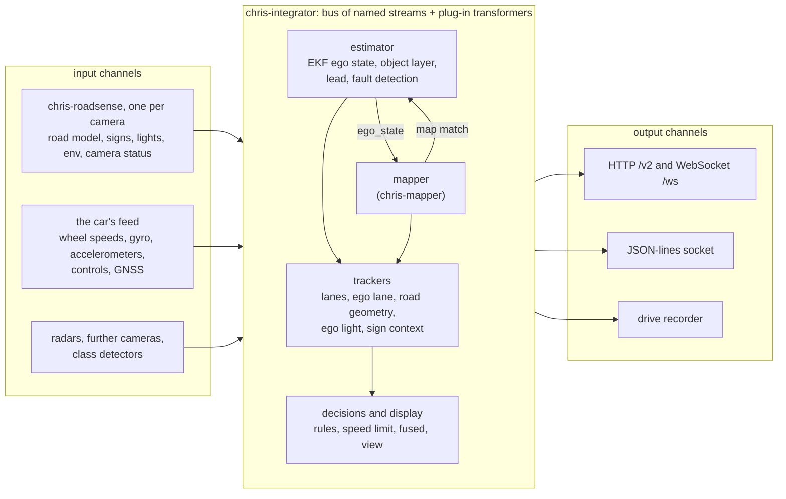

# chris-integrator

[](https://github.com/PiotrTopa/chris-integrator/actions/workflows/ci.yml)

The data integrator of **chris**, a perception stack for a car computer (named after St Christopher). Every
input of the car goes *in*: camera perception, the car's own motion and signals, GNSS, radars, more cameras.
One consistent picture comes *out*: where the car is and how it moves, what is around it, how far each of those
statements can be trusted, and the reason when it cannot be.

chris informs the driver. It does not control the car.

## Why a mixer

A car computer that grows sensor by sensor tends to end up with every consumer reading every sensor: the
display picks the camera's speed, the warning logic picks the wheel speed, a third piece of code guesses
whether the GNSS fix is fresh. chris-integrator is built like an audio mixer instead:

* **many inputs, many outputs**: input channels (one per camera instance, the car's feed, receivers, radars)
  and output channels (an HTTP / WebSocket API, a JSON-lines socket, a drive recorder) around one bus of named,
  time-stamped streams;
* **plug-in transformers** in between: each declares the streams it reads and the streams it writes; the order
  in which they run is derived from those declarations; any of them can be added, replaced, switched off or
  moved into another process without touching the rest;
* **inputs first, decisions after**: everything goes to the integrator before any logic sees it, and every
  decision (the lead vehicle, the speed limit in force, the ego traffic light) is taken here, on the fused
  inputs. A consumer never picks a raw sensor and never needs to know which sensors a particular car has;
* **metadata on everything**: every value carries its uncertainty, its age, whether it is a fresh fusion or a
  prediction (`mode: fused | coast | none`), which sources stand behind it, and `valid: false` always comes
  with a `reason`.

## Architecture



`GET /v2/mixer` shows the wiring as it runs: channels, streams with producer and consumers, the plug-ins in
running order with their health and cost. Design, with the alternatives that were considered:
[docs/DESIGN.md](docs/DESIGN.md) (section 14 is the mixer).

## What is in it

* **One ego estimate.** An extended Kalman filter over position, heading, speed, acceleration, yaw rate,
  altitude, road grade and the scale of the car's speed signal, plus the calibration states each source
  declares: gyro bias and scale, accelerometer offsets, per-sensor time delays, the camera's mounting angles, a
  receiver's correlated error, a radar's mount misalignment. Measurements are kept in a time-ordered buffer; a
  late one is inserted where it belongs and the filter is re-run from there; the state for a camera frame is the
  fixed-lag smoothed one.
* **Stated uncertainty that is meant to be right.** Heavy-tailed sources get Student-t weighted updates, errors
  correlated in time get Gauss-Markov states instead of inflated noise, states a measurement cannot separate are
  "consider" states (Schmidt-Kalman). The tests check NEES against simulated truth.
* **Fault detection and isolation.** Raw measurements of two sources are compared pairwise, never against the
  fused state; with three independent sources of a quantity the culprit is found by vote. Innovation statistics
  watch the row classes that have no partner. A faulted source leaves the estimate and everything built on it
  goes out as *unknown, with the reason*.
* **An object layer.** One track list in the car frame (`[x, y, vx, vy, ax]`, the car's own motion as the
  process model's input); sensors are models (measurement function, noise, field of view, clutter); global
  nearest-neighbour association, existence probabilities, cross-sensor merging by covariance intersection; the
  lead is the nearest confirmed track on the path. Object classes are non-critical metadata (a vote over the
  track's life), never used to gate a measurement.
* **Sources as plug-ins of the estimator.** A sensor is one file: an input description, a measurement model,
  its mount and calibration states. The core knows no sensor. Included: vehicle motion, road-model pose, GNSS,
  map match, the road model's lead, radar (any number, any mount), a further camera's object list, a road-user
  class detector.
* **The boxes of the stack** (`chris_integrator/plugins`, logic in `chris_integrator/trackers`): the estimator;
  lane lines; ego lane and fused road geometry; the ego traffic light; sign context; signs in effect and the
  speed limit (country rules as data, `trackers/rules/pl.json`); map + camera fusion; the display channel
  `view`; the map box (chris-mapper, optional).
* **The consolidated API** (`chris_integrator/io`): HTTP and WebSocket over the bus, a JSON-lines socket for
  other processes, a drive recorder, the car's direct feed as an input (vehicle input API 1.1).
* **A simulator with known truth** (`chris_integrator/sim`) that emits the same message types the real
  sources send, with noise, bias, latency, drop-outs and faults; and an injector that adds synthetic radars and
  cameras to a real recording, consistently with the car's recorded motion.

## Installing

Python 3.10 or newer and numpy. The HTTP / WebSocket API needs aiohttp; the map box needs chris-mapper. A C
compiler is optional (the native core, below).

```sh
git clone https://github.com/PiotrTopa/chris-integrator
git clone https://github.com/PiotrTopa/chris-mapper          # optional: the map box
python3 -m venv .venv && . .venv/bin/activate
pip install ./chris-mapper                                    # optional, before the integrator
pip install "./chris-integrator[http]"                        # builds the native core if a compiler is there
```

chris-mapper is not on PyPI; the `map` extra (`chris-integrator[map]`) only names the dependency, so install
chris-mapper from its checkout first. Without it the integrator runs and says so (no `mapper` box, no `map`
topic; the position estimate does not need the map). For a car computer without pip, `scripts/install.sh`
installs both trees side by side as a systemd unit ([docs/INSTALL.md](docs/INSTALL.md)).

```sh
cd chris-integrator && pip install pytest && python3 -m pytest -q tests
```

runs the suite (about 390 tests, 10 minutes on a laptop core: filter properties, simulated drives with truth,
sensors, faults, the mixer, the API end to end against a fake camera instance). The tests that need chris-mapper
or aiohttp are skipped without them.

## Quick start: the simulator

A simulated drive through the estimator box alone:

```python
from chris_integrator import Integrator
from chris_integrator.sim import World, default_sensors
from chris_integrator.sim.radar import RadarSim

world = World(seed=1, scenario="town")
sensors = default_sensors() + [RadarSim()]
integ = Integrator({"sources": [{"kind": "radar", "id": "*"}]})
for arrival, msg in world.messages(sensors):          # in arrival order: late and out of order as in a car
    if msg["type"] == "road":                         # one camera frame through the whole box
        ego_state, tracks, lead = integ.frame(msg)
        truth = world.truth_at(msg["ts_mono_ns"] / 1e9)
        print(ego_state["speed"]["value"], truth["v"], lead["dist_m"])
    else:
        integ.on_message(msg)
```

The same drive through the whole stack (every box, on a clock that follows the messages):

```python
from chris_integrator.mixer import MessageClock
from chris_integrator.stack import build

stack = build(clock=MessageClock())
stack.mixer.add_output("print", lambda env: print(env.stream, env.ts), streams=("lead", "lanes", "view"))
for arrival, msg in world.messages(sensors):
    stack.deliver(msg)                                # routed to its stream by `type`
print(stack.mixer.describe()["plugins"])              # order, health, cost per box
```

## Quick start: a replay

`chris_integrator.replay.Pipeline` is the stack with a recording as its input channel. A recording is JSON
lines (plain or gzip): the recorder's `messages.jsonl.gz` of a drive, or anything with the input contract below.
No recordings ship with this repository; the simulator makes one with truth:

```python
import gzip, json
from chris_integrator.sim import World, default_sensors
from chris_integrator.replay import Pipeline, read_session

world = World(seed=1, scenario="town")
with gzip.open("sim.jsonl.gz", "wt") as f:
    for arrival, msg in world.messages(default_sensors()):
        if arrival - world.t0 > 60:
            break
        f.write(json.dumps(msg) + "\n")

pipe = Pipeline()
for msg in read_session("sim.jsonl.gz"):              # or a recorder session directory
    for out in pipe.feed(msg):                        # what the API would have sent, in its order
        if out["type"] == "lead":
            print(out["ts_mono_ns"], out.get("dist_m"), out["valid"], out.get("reason"))
```

`read_session(..., pos=load_pos(FILE))` merges GNSS fixes kept outside the recording (for sessions recorded
before the receiver was an input); `load_pos` reads plain `gnss` lines and, as an example adapter, the reference
car computer's trip logs. The measurement tools built on the pipeline (lane, lead, fault-campaign and cost
replays) are in chris-roadsense's `tools/`.

As a daemon next to a running chris-roadsense instance:

```sh
python3 -m chris_integrator --roadsense /run/roadsense --http-port 8080
# reads the instance's sockets (camerad, modeld, signd, lightd, envd, laned, api),
# accepts the car's feed on <rundir>/feed.sock and POST /v2/vehicle,
# serves GET /v2/lead, /v2/view, ..., /v2/health, /v2/mixer and WebSocket /ws?topics=...,
# and JSON lines for other processes on <rundir>/integrator.sock (rundir: --rundir, default /run/chris)
```

By hand it listens on 8080 on all interfaces; an installed unit uses 8090 on loopback (docs/INSTALL.md).

## Input contract

JSON objects with a `type` and `ts_mono_ns`, the time of the *measurement* on the host's monotonic clock (a clock
that restarts is handled: a new epoch keeps the calibration and drops what was tied to the old time axis).

| type | from | fields used |
|---|---|---|
| `road` | chris-roadsense (road model) | `pose` (velocity in the device frame with stds, yaw rate), `leads[0]`, `plan`, `road_model`, `valid`; lane lines and road edges (the lane tracker) |
| `calib` | chris-roadsense | the calibration in use (pitch, yaw) and the camera's intrinsics |
| `lights`, `signs`, `env`, `camera` | chris-roadsense and its detectors | light and sign detections, place / weather / light, camera status |
| `governor` | chris-roadsense | its load governor's level and caps |
| `ego` / feeder `motion` | the car | `speed_mps`, `standstill`, `wheel_speeds_mps`, `yaw_rate_rps`, `accel_long_mps2`, `accel_lat_mps2`, `turn_signal` |
| `vehicle` / feeder `controls` | the car | `controls.brake` |
| `gnss` | a receiver | `fix`, `lat`, `lon`, `hacc_m`, `speed_mps`, `course_deg`, `alt_m` |
| `map` | the map box (chris-mapper), or an external matcher | `match`: matched point, bearing, confidence, ambiguity; the map context |
| `objects` | radars, cameras, class detectors | `sensor`, `kind`, per object range / azimuth / range rate, or x / y in the sensor's frame, or a `class` |
| `lights` + `road_users` | a camera's class detector | per box `cls`, `score`, `box`; placed with the camera's `calib` -> stream `road_users` |

No source is required. A car with a camera only gets a camera-only estimate that says so. The car's side of
the contract: [docs/VEHICLE_INPUT.md](docs/VEHICLE_INPUT.md).

## Output contract

The estimator box puts out three messages per camera frame (per vehicle sample while no camera runs), stamped
with the frame's time of validity:

* `ego_state`: `speed`, `accel`, `yaw_rate`, `heading`, `grade`, each `{value, std, valid, reason, mode, age_s,
  sources}`; `position` (lat, lon, local east / north, covariance); `odometer_m`; `standstill`; `calibration`
  (every estimated bias, scale, delay and mount angle with its std); `sources` (per source `absent | stale |
  unchecked | ok | suspect | fault`, the reason, how a fault was isolated); `checks` (every monitor's verdict).
* `tracks`: every track with id, state, existence probability, position / velocity / acceleration with std,
  the sensors behind it, flags (`standing`, `ghost`, `stationary`, `on_path`) and `class`.
* `lead`: the track on the path with distance, relative speed, time gap, time to collision, the sensors behind
  it, its `class`, and `valid` / `reason`.

The other boxes add `lanes`, `lights`, `signs`, `rules`, `speed_limit`, `map`, `fused` and `view` (the display
channel: one picture per frame for a screen; smoothed, informational, never fed back). All are served as
`GET /v2/<topic>` and on `/ws?topics=...`; field tables in [docs/TOPICS.md](docs/TOPICS.md).

## Adding a sensor

A source spec and a measurement model, registered with the estimator:

```python
from chris_integrator import Source, Meas, AuxState
from chris_integrator.core import ego as E
import numpy as np

class Barometer(Source):
    id = "baro"
    types = ("baro",)                                     # the message type it reads
    aux = (AuxState("bias", 0.0, 20.0, 1e-4, unit="m"),)  # a calibration state the estimator carries for it

    def measure(self, msg, ctx):
        ib = self.ix["bias"]
        idx, coef = np.array([E.Z, ib]), np.array([1.0, 1.0])
        h = lambda x: (x[E.Z] + x[ib], idx, coef)         # prediction and sparse Jacobian
        return [Meas("alt", msg["ts_mono_ns"] / 1e9, msg["alt_m"], 0.5, h, "baro.alt")]

integ.register(Barometer())
```

An object sensor returns a `Scan` with a `SensorModel` instead (`sources/radar.py`, `sources/camera_objects.py`).
Neither the core nor any consumer changes: the health table grows a row, tracks list the new sensor among their
sources, and the fault detectors compare it with every other source of the same quantity. docs/DESIGN.md
section 7.

## Writing a plug-in

A plug-in declares what it reads and writes and handles its trigger messages:

```python
from chris_integrator.mixer import In, Out, Plugin

class Headway(Plugin):
    """Seconds to the vehicle ahead, with a warning level."""
    name = "headway"
    DEFAULT_CFG = {"warn_s": 1.2}
    inputs = (In("lead", trigger=True), In("ego_state"))
    outputs = (Out("headway", kind="decision", time="frame", doc="time gap to the lead and its level"),)

    def on_input(self, stream, lead, ctx):
        es = ctx.get("ego_state", frame=True)            # this frame's, or None
        gap = lead.get("time_gap_s") if lead.get("valid") else None
        ctx.emit("headway", {"type": "headway", "ts_mono_ns": lead["ts_mono_ns"], "gap_s": gap,
                             "valid": gap is not None and es is not None,
                             "level": None if gap is None else "warn" if gap < self.cfg["warn_s"] else "ok"})

stack.mixer.add(Headway())             # or in mixer.json: {"plugins": [{"class": "mypkg.headway:Headway"}]}
```

It runs after the estimator because it reads `lead`; `/v2/headway` and `/ws?topics=headway` serve it; nothing
else was edited. Alone on a bench: `Bench(Headway()).feed("lead", lead_message)` (`chris_integrator.mixer.testing`).
In another process: `RemotePlugin(cmd=[...])`, with `remote.serve(Headway(), sys.stdin.buffer, sys.stdout.buffer)`
at the other end or any program that speaks the JSON lines (docs/DESIGN.md section 14.3).

## Fault detection

Every fault class of a taxonomy (vehicle speed, wheels, gyro, accelerometer, feeds, camera speed and mount,
camera lead, receiver, map, clock, pairs of faults, radar) is injected into a simulated drive and scored:
detected after how long, which source was isolated (or wrongly blamed), and for how many seconds an output was
published *valid* while wrong beyond its tolerance and 3 of its own sigmas. On the 59 faults of the reference
car's sensor set, with every detector gating: 56 detected, 38 isolated correctly, 2 wrong sources blamed,
confidently wrong output 737 s in all (1657 s before the fault-detection work).

Every detector that can set a source aside runs in a mode: `gate` (its verdict takes effect) or `report` (the
verdict and its evidence are published in `ego_state.diagnostics`, nothing is set aside). A detector gates by
default only if it stayed quiet, with a stated margin, on the reference car's healthy drives; three cannot be
made quiet on that car's sensors and report (with the default modes the 59 faults give 1355 s of confidently
wrong output: what the reporting detectors would have decided is the difference). The table of defaults, the
evidence behind each, and the full fault tables: [docs/FAULTS.md](docs/FAULTS.md); the mechanism:
docs/DESIGN.md sections 5-5b.

Not detectable with one camera, one speed chain and one receiver: which of two disagreeing sources is wrong
when no third exists, two sources wrong the same way, a wrong camera lead range, a slow drift of the receiver.

## The native core and the pure-Python fallback

The package is pure Python + numpy and complete as such. The per-message hot path's arithmetic and text work
(the filter's prediction, scalar update and smoother step, the lane tracker's arrays, JSON in and out,
`round`, the display box's table walk) also exists in one C file using the CPython limited API
(`chris_integrator/native/src/chris_native.c`). Where the compiled module is present and loads it is used; where
it is not, the same functions run in Python. The Python is the reference: text and the lane tracker give the
same bits, the filter agrees to rounding (numpy leaves the order of its sums of products to BLAS), and
`tests/test_native.py` holds the two together.

```sh
pip install .                       # builds the module when a C compiler and the Python headers are there
CHRIS_NATIVE_BUILD=0 pip install .  # pure Python on purpose
sh native/build.sh                  # build it in the source tree (used at the next import)
sh native/cross-build.sh            # a module for an aarch64 musl phone, built in a container (docker + qemu)
python3 -m chris_integrator.native  # which implementation runs here, and a self-test against the reference
CHRIS_NATIVE=0 python3 -m chris_integrator ...   # run pure Python although the module is there
```

Wheels are `cp311-abi3` (one binary for every CPython >= 3.11 of a platform); on 3.10 the package is pure
Python. Compiled modules are never committed: `native/dist/` and `*.so` are build output. On the reference
phone the native core halves the cost of the per-message path (below). [docs/NATIVE.md](docs/NATIVE.md) has the
contract of each function, why the exact parts are exact, the parser's memory safety and how to write a native
plug-in.

## Status and limits

Working and tested: everything listed above, in simulation with truth and on recordings of the reference
deployment. What that does and does not show:

* **Radar and a second camera are proven only in simulation**, and on synthetic sensors injected into real
  recordings (consistent with the car's recorded motion), not on a real radar or a real second camera.
* **The real-data evidence is a few drives of one car.** The defaults of the fault detectors and every
  real-world position number rest on two vehicle-fed healthy drives (38 and 15 minutes) on one day, the incident
  numbers on two drives, monitor thresholds on town driving in daylight. The margins are thin where they matter:
  `self_check`, the detector that catches the camera faults seen on the car, reached 0.65 of its firing level on
  a healthy drive.
* **Position on poor satellite reception is the weakest output.** The reference car's receiver sees 3-5
  satellites at times; on the drive with the poorest reception, held-out fixes lay 63 m from the estimate
  through the map box (against 24 m for the legacy matcher it replaced) and the map was available 83.5 % of the
  driving: not fixed. The stated position uncertainty is optimistic on the car (normalised errors 5-7 where 2 is
  expected), and a persistent offset of the only absolute source cannot be told from a movement of the car.
* **Parallel roads**: a parallel road nearer than about 3 of the receiver's sigmas (12 m for a receiver good to
  3 m; 35-40 m for the reference car's on few satellites) cannot be told from the receiver's error. The answer is
  the stated uncertainty across the road, not a detection (docs/FAULTS.md, "The receiver distrusted").
* **The cost is Python logic.** About 3 ms per camera frame on a laptop core for the whole stack; on a phone's
  little core (Snapdragon 845, 1.77 GHz) 15-21 ms pure Python and 8-9 ms with the native core, 26 % of the core
  live at 15 frames a second where pure Python takes 38 %. About four fifths of what remains is Python byte code
  in the estimator's bookkeeping, the trackers' decisions and the mixer, not arithmetic (docs/DESIGN.md 14.7).
* No 6-axis IMU is modelled: roll and bank are not states, grade and accelerometer bias are separable only with
  an altitude source, sideslip is ignored.
* The car's direct feed is taken as it comes: the validation, per-signal quality and the car description a
  feeder may send (vehicle input API 1.1) are not yet carried into the `vehicle` topic.
* A second chris-roadsense instance is wired as a channel (its streams suffixed with the instance name); a
  second road-model pose as an estimator source is not built. Out-of-process plug-ins are exercised by tests and
  replays, not yet on a car.

## The chris stack

| repository | what | licence |
|---|---|---|
| [chris-roadsense](https://github.com/PiotrTopa/roadsense) | per-camera perception on the car computer: camera capture, the road model, sign / light / scenery detectors' daemons, the debug face; the replay and measurement tools; the lane reports | MIT |
| chris-integrator (this) | every input in, fusion, trackers, decisions, the consolidated API | MIT |
| [chris-mapper](https://github.com/PiotrTopa/chris-mapper) | the map box: map matching and map context from OpenStreetMap packs | MIT |
| roadsense-signs | the sign and traffic-light detectors | AGPL, separate |

chris-integrator contains no code of roadsense-signs. It reads the *messages* its detectors publish (`signs`,
`lights` with `road_users`) over a socket, as it reads any input; the sign class names it maps to rules are
strings in those messages. A deployment without those detectors runs without the sign and light boxes' inputs.

Numbers in the documents often name where they were measured: "lane Lnn" is a work report in chris-roadsense's
[`docs/lanes/`](https://github.com/PiotrTopa/roadsense/tree/main/docs/lanes), and `tools/...` names a
chris-roadsense tool unless it is one of this repository's own `tools/` (cost and native benchmarks). Those
reports describe the code as it was when they were written; this repository's documents describe it as it is.

## Reference deployment

A second-generation Toyota Prius with a Poco F1 phone (postmarketOS) as the car computer, running chris-roadsense
and this integrator; a separate project feeds the car's CAN signals and draws the multi-function display from
the consolidated API. That deployment is the test bed, not a requirement: the integrator is car-agnostic and
depends on neither.

## Documents

[docs/DESIGN.md](docs/DESIGN.md) (estimator, fault detection, object layer, the mixer, the map loop),
[docs/FAULTS.md](docs/FAULTS.md) (which detectors gate; the fault tables), [docs/TOPICS.md](docs/TOPICS.md)
(field tables of the consolidated topics), [docs/VEHICLE_INPUT.md](docs/VEHICLE_INPUT.md) (the vehicle input
API as served here), [docs/INSTALL.md](docs/INSTALL.md) (install script, units, ports, rollback),
[docs/NATIVE.md](docs/NATIVE.md) (the native core).

## Licence

MIT, see [LICENSE](LICENSE). Map data is not part of this repository (chris-mapper's packs are built from
OpenStreetMap, ODbL). The two lead-distance series in `tests/data/` are numbers computed from public videos
(CC BY 3.0, sources named in each file); no recording of the reference deployment is included.
