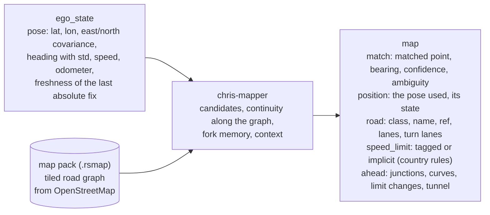

# chris-mapper

[](https://github.com/PiotrTopa/chris-mapper/actions/workflows/ci.yml)

The map box of **chris**, a perception stack for a car computer (named after St Christopher). A pose goes in;
which road that is, and what the map says about it, comes out. It estimates no position: where the car is, is
the statement of the component that fuses the sensors ([chris-integrator](https://github.com/PiotrTopa/chris-integrator)),
taken with its uncertainty.

chris informs the driver. It does not control the car.

## Why a separate box

In chris every input goes to the integrator first and every decision is taken there, on fused inputs. The map
is one of those inputs, with a twist: the match is made from the integrator's own estimate, and its geometry
goes back into that estimate as a measurement. Keeping the map in a box of its own keeps that loop explicit:

* **no position filter here**: a pose that is 30 m off the road comes out 30 m off the road, with a match that
  says so. Position is estimated once, in the integrator;
* **a hypothesis, not a fact**: which road the car is on is reported with the other candidates' lines and their
  shares (`match.weight`, `match.alternatives`), how well the winner fits, and how much the road turns around the
  matched point, so that the pose source does not take "probably this road" for "this road";
* **its own data and state**: the map pack (a tiled road graph built from OpenStreetMap), a tile cache, its own
  test world (a road network rather than a drive). A host can run it in the integrator's process or as a process
  of its own on other cores, behind the same contract.



## Installing

Python 3.10 or newer and numpy; nothing else.

```sh
git clone https://github.com/PiotrTopa/chris-mapper
pip install ./chris-mapper
cd chris-mapper && pip install pytest && python3 -m pytest -q tests
```

With chris-integrator: install chris-mapper first, then the integrator (its README, "Installing"). The
integrator finds the box at start-up and adds it to its mixer; without it, it runs without a map. Neither
package imports the other's internals: the contract is the messages.

## Quick start

No map data ships with this repository. `chris_mapper.synthpack` writes a small hand-made road network as a
real pack (a main road with tagged and implicit limits, a tunnel, a bend, side streets, a motorway, parallel
roads), which is what the tests use:

```python
from chris_mapper import synthpack
from chris_mapper.box import MapBox

synthpack.build("synth.rsmap")
box = MapBox({"pack": "synth.rsmap"})
t = 100.0
for k in range(400):                              # 14 m/s eastwards along the main road, 2 m north of it
    x = 50 + 14.0 * 0.5 * k
    lat, lon = synthpack.ll(x, 2.0)
    m = box.on_ego_state({"type": "ego_state", "ts_mono_ns": int(t * 1e9),
                          "position": {"valid": True, "mode": "fused", "lat": lat, "lon": lon,
                                       "cov_en": [16.0, 0.0, 16.0], "fix_age_s": 0.5, "local": {"frame": 1}},
                          "heading": {"value": 90.0, "std": 3.0, "valid": True},
                          "speed": {"value": 14.0, "valid": True}, "odometer_m": x})
    t += 0.5
    if m is not None:                             # a `map` message every 0.45 s of input time
        print(round(x), m["state"], m["road"]["name"], m["speed_limit"]["limit_kmh"], m["ahead"]["tunnel"])
```

`chris_mapper.sim` routes through a pack and simulates a drive with the feeder messages a car would send
(noise, drop-outs, a receiver on few satellites), for tests with truth.

## The box

* **In**: `ego_state` messages. Used fields: `ts_mono_ns`; `position` (`valid`, `mode`: `fused` while an absolute
  fix is fresh, `coast` in dead reckoning; `lat`, `lon`, `cov_en`, `fix_age_s`, `local.frame`); `heading`
  (`value` in degrees clockwise from north, `std`, `valid`); `speed.value`; `odometer_m`.
* **Out**: `map`. `match` is geometry of the map (the matched road's point and bearing): the estimator takes it
  as a measurement (cross-track distance to the road = 0, heading = the road's bearing), so the loop estimator
  -> map -> estimator does not feed a pose back to itself. `position` repeats the pose that was used with its
  state (`good`, `dead_reckoning`, `unknown`, `no_source`). `road`, `speed_limit`, `ahead` are the map context.
  Field by field: [docs/MAP.md](docs/MAP.md).
* No sensor input, no position filter, no wall clock: times are the input's. A changed pack file is loaded
  without a restart.

Three ways to run it:

```sh
# in a chris-integrator process (default when installed): the integrator's `mapper` plug-in wraps MapBox
# as its own process, behind the plug-in wire contract (a hello line with inputs and outputs, then JSON lines):
python3 -m chris_mapper --plugin --pack PACK
# offline: `ego_state` lines of a file in, `map` lines out
python3 -m chris_mapper --replay EGO_STATES.jsonl --pack PACK
```

| module | what |
|---|---|
| `box.py` | the box: pose in, `map` out |
| `rsmap.py` | the map pack format (`.rsmap`: tiled road graph with attributes) |
| `matcher.py` | map matching: candidates by distance and heading, continuity along the graph, fork memory |
| `context.py` | road attributes, implicit limits (`limits/<country>.json`), look-ahead, junction and roundabout views |
| `sim.py` | routes and a simulated drive on a pack (truth for tests) |
| `synthpack.py` | the hand-made test network |

## Map packs

A pack is a tiled road graph with attributes (class, name, ref, lanes, turn lanes, maxspeed, built-up area,
tunnel, bridge, features such as traffic signals and crossings) in one memory-mapped file; the format is in
[docs/PACK.md](docs/PACK.md). Packs are built from OpenStreetMap extracts by the pack builder, which today lives
in chris-roadsense ([`tools/roadsense_maps.py`](https://github.com/PiotrTopa/chris-roadsense/blob/main/tools/roadsense_maps.py),
[`docs/MAPS.md`](https://github.com/PiotrTopa/chris-roadsense/blob/main/docs/MAPS.md)). Map data is (c) OpenStreetMap
contributors, ODbL; no map data is part of this repository.

## Status and limits

* Implicit speed limits (a road without a `maxspeed` tag) follow country rules from `limits/<country>.json`;
  only Poland (`pl.json`) is written.
* The pack builder is not in this repository (above); this repository reads packs and writes test packs.
* Matching is as good as the pose it is given. On the reference car's receiver with 3-5 satellites the pose can
  be tens of metres off; the box then matches what it is given and says how sure it is. A parallel road nearer
  than about 3 of the receiver's sigmas cannot be told apart by any matcher that reads only the pose: the box
  reports both candidates and their shares, and the integrator turns that into uncertainty across the road
  (chris-integrator `docs/FAULTS.md`, "The receiver distrusted").
* One hypothesis per match with alternatives, not a multi-hypothesis matcher over time (an HMM over raw fixes):
  that is the next step if the candidates' shares prove too crude at junctions (chris-integrator
  `docs/DESIGN.md` section 15a).
* Real-world evidence is a few drives of one car (the reference deployment below); the behaviour at junctions,
  forks and roundabouts is tested on the hand-made network.
* Cost: 0.4-0.9 ms per match on a laptop core, about 2 matches a second: about 1 % of a phone's little core by
  estimate.

## Reference deployment

A second-generation Toyota Prius with a Poco F1 phone (postmarketOS) as the car computer, running
chris-roadsense, chris-integrator and this box in the integrator's process; the multi-function display is drawn
from the consolidated API by a separate project. The box itself is car-agnostic.

## The chris stack

[chris-roadsense](https://github.com/PiotrTopa/chris-roadsense) (per-camera perception, MIT),
[chris-integrator](https://github.com/PiotrTopa/chris-integrator) (fusion and the consolidated API, MIT),
chris-mapper (this, MIT). The sign and light detectors (roadsense-signs) are a separate AGPL project; nothing of
them is in this repository. "Lane Lnn" in the documents names a work report in chris-roadsense's
[`docs/lanes/`](https://github.com/PiotrTopa/chris-roadsense/tree/main/docs/lanes).

## Licence

MIT, see [LICENSE](LICENSE).
