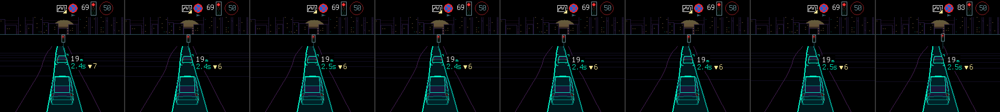
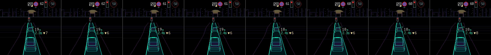

# L19: a live lead at standstill, a display channel (`view`), and what the MFD draws

Built 2026-11-18 on the dev box (laptop), roadsense 2.0 campaign. Nothing was deployed; the phone was not touched.
Branches: roadsense `v2-l19`, car computer `v2-l19` (both unpushed). Contract: docs/ARCHITECTURE.md ("api-derived
topic lead", "api-derived topic view", the measurement / display rule under "api"); car side:
docs/MFD_MAIN_SCREEN.md 7.4.

Owner's complaints (2026-11-18):

1. "the car leading visualisation is strange, it freezes until the car starts. I wanted a more stable reading,
   but not by forcing it when the car stands still."
2. "traffic light positions, lanes, some objects are visualised jumping. We should have Kalman-like filtering,
   but security first, visualisation second ... maybe we need a separate filtered data channel for
   visualisation that the MFD and similar systems would use."

## Data

The car's drive-recorder sessions in `~/roadsense-rec` (14 sessions, read-only, not in the repo): drives
20261112-141112 (19 min), 20261117-101013 (29 min, day), 20261117-145921 (71 min, of it long standing),
20261117-163836 (12 min), 20261117-190932 / -191703 (6 + 5 min, evening), 20261117-220714 (20 min, night, almost
no lead and no lights); parked: 20261116-115104, 20261117-132015, 20261117-224454, 20261118-095209 (39 min, no
lane line, lead or light at all); three short 2026-11-18 sessions without road messages. The recorder keeps
`road` (reduced), `lights` (annotated as sent), `signs`, `ego` (the car's wheel speed and yaw rate), `map`; the
`lead`, `lanes` and `view` topics are recomputed from them exactly as the api does. Several files end in a broken
gzip block (phone reset / copy cut): the replay tools now read up to the last complete line.

## Where the faults sat

| complaint | roadsense | transport (api -> backend -> Pi) | MFD drawing |
|---|---|---|---|
| lead freezes while standing | **yes**: the L14 `hold` mode froze `dist_m` while both stood; on the drives frozen for up to 32 min (20261117-145921), 227 s on the day drive, the frozen value 0.17-0.37 m rms (max 1.03 m) away from what the camera said over 2 s | no | **yes**: the road picture (lanes, lead, light) was only redrawn while the car moved or something in the HUD changed: standing, it froze whatever roadsense sent (see the standing table) |
| traffic light jumps | **the measurement is what it is**: the light's distance comes from its housing size, frame by frame, 3 times a second: median step 0.6 m, p95 9.3 m (34 %) per message on the day drive. The `lights` topic is right to say that; nothing smoothed it for drawing | 4.5 % of the scenes carried the previous frame's lead / lanes (scene built on `road`, before `lead` / `lanes` of the same frame arrived) | **yes**: drawn as it came (no filter), placed with the offset from the planned path as if it were from the camera axis, and when the scene had no light the 5 s health mirror's old light was drawn: 6-32 % of the frames with a light on the drives were a light roadsense no longer reported |
| lanes jump | already filtered (`lanes`, L15): what remained were lines that come and go without a fade (106 per 29 min on the day drive) | as above | 0.3 s low-pass on the newest sample: smooth but late; no fades |
| "some objects" | the only objects on the MFD are the lead, the light and the roadside scenery standing on the road edges (L15 fixed the tree bug); the edges come from `lanes` | | |

## What changed

### roadsense: `lead` stays live (measurement topic, better quality)

The `hold` mode is gone. While both stand the filter switches to a standing model (ego speed exactly zero, the
lead's speed measured with the model's very good standstill speed output, low jerk noise, a distance random walk
that averages the per-frame jitter over about 3 s, Huber down-weighting of frames beyond 2.5 sigma), one update per
frame, never frozen. The lead-speed CUSUM now runs before the distance gate (a lead that rolls off makes the
distance jump out of the narrow standing filter; before, such a frame was taken for an outlier and the
departure became a track change on the a1-s8-rain test span). `standing`, `departed`, `gap_changed`, `coast`
with `meas_age_s` remain; mode `hold` no longer exists.

Standstill behind a standing lead (spans of `tools/lead_replay.py`: ego under 0.1 m/s, lead under 15 m and
standing, first second skipped), before = main, after = `v2-l19`:

| session | standing | raw step rms | before: step / longest constant / off the camera's 2 s mean rms (max) | after: step / longest constant / off the 2 s mean rms (max) | whole-metre changes, after: plain / with 0.3 m hysteresis (raw with hysteresis) |
|---|---|---|---|---|---|
| 20261112-141112 | 165 s | 0.175 m | 0.003 m / 32.6 s / 0.232 (1.03) m | 0.017 m / 0.5 s / 0.098 (0.54) m | 73 / 5 (16) |
| 20261116-115104 | 175 s | 0.119 m | 0.001 m / 173 s / 0.196 (0.38) m | 0.009 m / 0.9 s / 0.020 (0.10) m | 96 / 0 (2) |
| 20261117-101013 | 473 s | 0.119 m | 0.005 m / 227 s / 0.175 (0.83) m | 0.011 m / 0.9 s / 0.034 (0.37) m | 105 / 0 (9) |
| 20261117-132015 | 597 s | 0.105 m | 0.001 m / 472 s / 0.205 (0.82) m | 0.009 m / 1.0 s / 0.030 (0.47) m | 143 / 1 (11) |
| 20261117-145921 | 3769 s | 0.125 m | 0.003 m / 1945 s / 0.267 (0.88) m | 0.010 m / 1.2 s / 0.023 (0.38) m | 418 / 1 (19) |
| 20261117-163836 | 64 s | 0.103 m | 0.002 m / 52.5 s / 0.178 (0.28) m | 0.010 m / 0.7 s / 0.041 (0.22) m | 4 / 0 (1) |
| 20261117-190932 | 76 s | 0.231 m | 0.022 m / 40.8 s / 0.372 (0.89) m | 0.021 m / 0.6 s / 0.103 (0.84) m | 16 / 0 (20) |
| 20261117-191703 | 110 s | 0.220 m | 0.008 m / 34.5 s / 0.263 (0.69) m | 0.018 m / 0.6 s / 0.073 (0.42) m | 10 / 2 (21) |

Readings: the frame-to-frame jitter is 6-13 times below the raw value's; the value is never frozen (at most 1.2 s
the same to the centimetre); it stays 3-10 times closer to what the camera says than the frozen value did. What
a live value shows is the network's slow wander of its close-range distance (sd 0.07-0.2 m over a stop): a
display that rounds to whole metres must add a hysteresis, and with 0.3 m it changes 0-5 times in a session's
standing time. Moving, nothing changed (bands 6-200 m identical); in 0-6 m the rms against the 1 s median
reference fell from 0.177 to 0.069 m (day drive) and 0.294 to 0.166 m (141112), because the reference follows
the camera and the old hold did not. Departures: the same five on the day drive at the same times (0.21-1.13 s
after the lead began to roll). Synthetic and real-span tests rewritten to the new requirement (steady, live,
display-hysteresis 0 flips, departure as before): `api/tests/test_lead.py`.

Commands:
```sh
tools/lead_replay.py ~/roadsense-rec/20261117-101013/messages.jsonl.gz                          # after
tools/lead_replay.py ~/roadsense-rec/20261117-101013/messages.jsonl.gz --api ~/projects/roadsense/api   # before (main)
```

### roadsense: display channel `view` (new topic, `/v1/view`, `/ws?topics=view`)

`api/roadsense_api/view.py`, one message per road frame after `lead`, `lanes`, `roadgeom`; format and filter
table in docs/ARCHITECTURE.md. Generic objects (`lead:<id>`, `light:<id>`, `sign:<id>`) and lines (`lane:0..3`,
`edge:0..1`, `path`) in the car frame with velocities, sigmas, `meas_age_s`, `phase` and `alpha`; `road: null`
is the slot for the fused road geometry (lane L20). It is derived from the measurement topics and never feeds
them (test `test_inputs_are_not_modified`, `test_view_follows_lead_and_lanes_and_never_feeds_back`).

Per road frame (what a consumer drawing at the model's rate sees), `tools/view_replay.py`:

| session | ego light: drawn distance step after the car's motion, rms; steps over 2 m | lateral step rms | lines popping on/off without a fade | lead: drawn step after its relative speed, rms |
|---|---|---|---|---|
| 20261112-141112 | 0.88 -> 0.10 m; 11 -> 0 | 0.148 -> 0.050 m | 80 -> 1 | 0.198 -> 0.065 m |
| 20261117-101013 | 1.96 -> 0.12 m; 129 -> 0 | 0.315 -> 0.071 m | 106 -> 2 | 0.273 -> 0.093 m |
| 20261117-145921 | 2.05 -> 0.27 m; 65 -> 0 | 0.357 -> 0.138 m | 59 -> 0 | 0.068 -> 0.025 m |
| 20261117-163836 | 0.82 -> 0.04 m; 16 -> 0 | 0.250 -> 0.016 m | 44 -> 0 | 0.308 -> 0.139 m |
| 20261117-190932 | 0.94 -> 0.03 m; 41 -> 0 | 0.308 -> 0.024 m | 36 -> 1 | 0.135 -> 0.058 m |
| 20261117-191703 | 1.55 -> 0.08 m; 16 -> 0 | 0.288 -> 0.028 m | 38 -> 0 | 0.121 -> 0.060 m |

("before" = the measurement topic held between its messages, which is what the MFD drew.) The lines' display
lag behind `lanes` is one frame. Cost: 0.15-0.18 ms per road frame on the laptop (i7-8850H, one core), about 1.5 kB
per message (13 messages a second on /ws).

```sh
tools/view_replay.py ~/roadsense-rec/20261117-101013/messages.jsonl.gz [--ws WS.jsonl.gz]
```

### car computer (branch `v2-l19`)

* backend `roadsense_scene.py`: subscribes to `view`; while it is fresh the scene is built per `view` message
  (the frame is complete), the top-level keys stay the measurement (alerts), and a block `vw` carries what is
  drawn (lead, ego light in the car frame with velocity, lanes / edges with fades, path, the frame time `t`).
  The 15 kB `road` message is not decoded any more in that mode. Without `view` nothing changes.
* frontend: draws lead, light, lanes, path from `vw`; places samples on its own clock by `t` (min of arrival -
  frame time over 3 s) and carries lead and light by their velocity to the frame being drawn, easing only
  corrections; the light at its car-frame position; no health-mirror light while the feed is live; whole-metre
  read-outs of the lead and the light with a 0.3 m hysteresis; the road picture redrawn while standing whenever
  it moved by about a pixel (capped at `fps_scene`).

What the glass shows, `tools/scene_feed_replay.py` in the car repo (backend loop, ZMQ 50 ms poll, link, UI at
20 Hz, headless renderer), before = car `main` without `view`, after = `v2-l19` with it, same stream:

| session | scenes with lead / lanes of another frame | ego light drawn: step after the car's motion rms; > 2 m | light drawn while roadsense had none | lead drawn vs the tracker at the drawn moment, rms |
|---|---|---|---|---|
| 20261112-141112 | 4.6 % -> 0.03 % | 0.72 -> 0.07 m; 14 -> 0 | 32.4 % -> 1.0 % | 0.97 -> 0.75 m |
| 20261117-101013 | 4.5 % -> 0.03 % | 1.76 -> 0.08 m; 192 -> 0 | 14.0 % -> 0.2 % | 1.51 -> 1.26 m |
| 20261117-145921 | 4.2 % -> 0.01 % | 1.68 -> 0.18 m; 73 -> 0 | 19.0 % -> 0.1 % | 0.27 -> 0.28 m |
| 20261117-163836 | 4.4 % -> 0 % | 0.66 -> 0.03 m; 17 -> 0 | 9.4 % -> 0 % | 1.74 -> 1.39 m |
| 20261117-190932 | 4.7 % -> 0.1 % | 0.83 -> 0.02 m; 44 -> 0 | 6.4 % -> 0.1 % | 0.73 -> 0.49 m |
| 20261117-191703 | 4.8 % -> 0.1 % | 1.20 -> 0.05 m; 18 -> 0 | 16.0 % -> 1.5 % | 0.91 -> 0.58 m |

Standing with a lead and the road view open (the replay keeps gear D, so this is the stop-and-go standing; a
real parked car closes the view):

| session | standing | before: scene redraws/s; longest without a redraw | after: redraws/s; longest without a redraw | lead read-out changes while both stand, after (before: frozen) |
|---|---|---|---|---|
| 20261112-141112 | 198 s | 1.7; 36.2 s | 7.7; 1.5 s | 6 in 179 s (2.0/min) |
| 20261117-101013 | 514 s | 0.7; 226.7 s | 3.8; 15.3 s | 6 in 479 s (0.8/min) |
| 20261117-145921 | 83 s | 1.0; 18.0 s | 7.4; 2.1 s | 3 in 60 s (3.0/min) |
| 20261117-163836 | 72 s | 0.3; 22.8 s | 4.7; 2.2 s | 1 in 67 s (0.9/min) |
| 20261117-190932 | 105 s | 9.0; 10.0 s | 12.3; 1.1 s | 3 in 94 s (1.9/min) |
| 20261117-191703 | 117 s | 1.7; 26.8 s | 7.3; 2.4 s | 3 in 112 s (1.6/min) |

Before, the picture stood still for tens of seconds to minutes while the car stood (only HUD changes redrew it);
after, it is redrawn whenever the lead, a line or the light moved by about a pixel, and a 15 s stretch without a
redraw is a lead that really did not move. The read-out (whole metres, 0.3 m hysteresis) changes about once or
twice a minute while standing: that is the network's own slow wander, now shown instead of frozen. A larger
hysteresis (0.5 m) is a one-line tunable if the owner finds it too lively.

The remaining "light while roadsense has none" (0-1.5 %) is the view's fade-out (0.3 s, drawn dimmer). Lanes:
the drawn lateral step at 10 m is unchanged (0.006-0.012 m rms), at 30 m slightly larger (0.037 -> 0.042 m on the
day drive; steps over 0.3 m 15 -> 56 in 29 min, all in turns) because the 0.3 s low-pass became a 0.1 s ease: the
lines lag about 0.2 s less. The drawn lead's per-frame step is about the same as with the 0.3 s low-pass
(0.06-0.10 m rms moving) while it is 15-35 % closer to the tracker's current value.

Frame strip (8 consecutive UI frames, 20 Hz, day drive at 832 s, approaching a red light at 7 m/s; distance
read-out top right, the light on its mast over the road):

| before (`main`) | after (`v2-l19`) |
|---|---|
|  |  |

Before, the light sits at 69 m for seven frames and jumps to 83 m (it is approaching); after, 62 -> 60 m, one
metre at a time.

```sh
# in the car repo, with a stream written by roadsense tools/view_replay.py --ws
.venv-fe/bin/python tools/scene_feed_replay.py WS.jsonl.gz                      # after
.venv-fe/bin/python tools/scene_feed_replay.py WS.jsonl.gz --no-view --repo ~/projects/cyberpank-prius-gen2-computer   # before
```

## Transport

* Rate: the backend publishes at most 10 scenes a second (modeld runs 12.5-13.8 Hz), so 9-10 scenes a second
  reach the Pi; the newest sample is 190-200 ms old (median; p95 255-275 ms) when a frame is drawn: model
  latency (~60 ms), the publish cap, the ZMQ poll (0-50 ms), the UI loop (0-50 ms). This did not change; the
  frontend now places samples by their frame time and extrapolates the lead and the light, so the age no longer
  shows as a lag of the moving light, and jitter of the path no longer moves the picture. The link to the Pi was
  modelled (5 ms + exponential jitter), not measured.
* Mixed frames: fixed by building the scene on `view` (4.2-4.8 % -> 0-0.1 %).
* Event size: 1.14 kB -> 1.50 kB mean (p95 1.42 -> 2.01 kB) at about 10 Hz; decode + parse on the laptop
  0.043 -> 0.066 ms per event (x70 on the Pi Zero: about 3 -> 4.6 ms, 3 -> 5 % of its core). The backend's work
  per published scene is unchanged on the reduced recorder stream (0.51-0.55 ms); on the car it drops, because
  the 15 kB `road` message is no longer decoded.

## Open

* Nothing here has run on the phone or the car. To verify: deploy roadsense `v2-l19` (api only) and the car
  computer `v2-l19` (backend + frontend), drive with the recorder, then the two replay tools above on that session;
  on the car look at a stop behind a car (live distance, no number flipping), and an approach to a light.
* The Pi link's real latency and jitter are not known (modelled).
* Raising the publish cap to 15 Hz would send every frame (about -40 ms of age, +50 % bytes); not done, a decision.
* The view's light distance trusts odometry between detections; with a mis-sized housing it is corrected over
  seconds. A detector-independent range for lights (stop line, map signal distance) would help; not in this lane.
* Signs are in `view` (distance from a 0.7 m sign); the MFD does not draw signs in the world (it has the sign row).
* `view.road` is reserved for lane L20's fused road geometry; the MFD still takes `geo` from `roadgeom`.
* The 20261118-095209 session (39 min, parked) has no lane line, lead or light at all: unexplained here.
